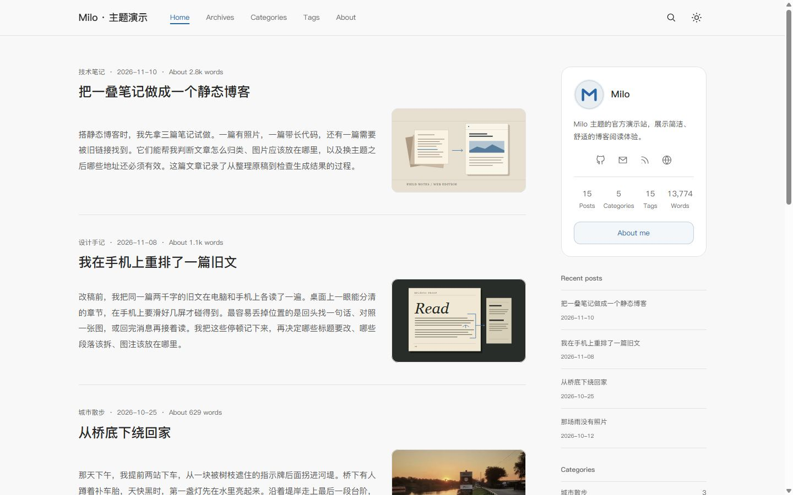

# Milo

[简体中文](README.md) · English

Milo is a lightweight Hexo theme for personal blogs. It puts writing and the author's profile first, using EJS, CSS, and plain JavaScript with a responsive layout.

[Live demo](https://demo.tanwenhao.com) · [User guide](docs/en/README.md) · [Configuration reference](docs/en/configuration.md)



The screenshot shows the local v0.6.0 candidate. The live demo may run a different version. The npm tarball includes the written guides. Browse the [screenshots on GitHub](https://github.com/twhao/hexo-theme-milo/tree/main/docs/images/guide).

## Features

- Simplified Chinese and English interfaces, with light, dark, and system appearance modes.
- Post covers and excerpts, pre-generated WebP variants, a table of contents, reading progress, code copying, and an optional lightbox.
- Author profile, custom navigation, social links, static full-text search, archives, categories, and tags.
- Built-in Atom feed, social sharing metadata, and optional Disqus comments.

## Quick start

You need Node.js, npm, and a working Hexo site. Git installation also requires Git. Milo declares Node.js 18+, and Hexo 8.1.2 requires Node.js 20.19+. Use a supported Node.js LTS release. Node.js 22, 24, and 26 have been tested with Hexo 8.1.2. If you are new to Hexo, start by [creating a site](docs/en/README.md#installation).

### Install the candidate with npm

Run `npm pack` in the candidate source directory. Put the resulting tarball in your Hexo site root, then run:

```sh
npm install ./hexo-theme-milo-0.6.0.tgz
```

The candidate has yet to be published on npm. After the package is publicly available, use `npm install hexo-theme-milo`.

### Install with Git

Run these commands from your site root:

```sh
git clone https://github.com/twhao/hexo-theme-milo.git themes/milo
npm install --prefix themes/milo --omit=dev
```

The clone uses the current default branch. To select a fixed version, follow the [installation guide](docs/en/README.md#installation) for tags and source archives.

### Enable and preview

In your site root, edit `_config.yml`:

```yaml
theme: milo
language: en
```

Install the renderers, generators, and development server required by the site, then start the preview:

```sh
npm install hexo-renderer-ejs hexo-renderer-marked hexo-generator-index hexo-generator-archive hexo-generator-category hexo-generator-tag hexo-server
npx hexo clean
npx hexo server --ip 127.0.0.1
```

Open the local address printed in the terminal. Copy either the [English-commented template](_config.en.yml.example) or the [Chinese-commented template](_config.yml.example) to your site root as `_config.milo.yml`. Both have the same settings. The [user guide](docs/en/README.md#pages-and-navigation) shows how to create search, category, tag, and about pages.

To try custom colors, an author profile, navigation, and the lightbox together, start with the [Demo configuration example](examples/_config.milo.yml) instead. Its opening comments list where to copy the companion pages. The theme includes the sample image.

## Resources

- [Changelog](CHANGELOG.md) · [Upgrade and uninstall](docs/en/README.md#upgrade-and-uninstall) · [Troubleshooting](docs/en/README.md#troubleshooting)
- [Report an issue](https://github.com/twhao/hexo-theme-milo/issues) · [Releases](https://github.com/twhao/hexo-theme-milo/releases) · [MIT license](LICENSE)
