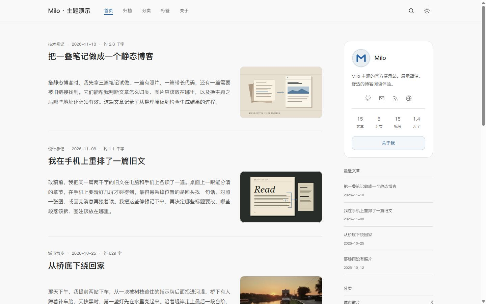

# Milo

简体中文 · [English](README.en.md)

Milo 是一款轻量的 Hexo 博客主题。它把文章和个人主页放在首位，使用 EJS、CSS 和原生 JavaScript，页面随屏幕尺寸调整。

[在线 Demo](https://demo.tanwenhao.com) · [完整使用指南](docs/zh-CN/README.md) · [配置参考](docs/zh-CN/configuration.md)



截图展示 Milo v0.6.0。更多功能截图见[使用指南](docs/zh-CN/README.md)。

## 功能概览

- 简体中文和英文界面，浅色、深色及跟随系统模式。
- 文章封面与摘要、预生成 WebP、目录、阅读进度、代码复制与可选灯箱。
- 作者卡片、自定义菜单与社交链接、静态全文搜索、归档、分类和标签。
- 内置 Atom 订阅、分享元数据及可选 Disqus 评论。

<a id="安装与启用"></a>

## 快速开始

需要 Node.js、npm 和一个可构建的 Hexo 站点。Git 安装还需要 Git。Milo 声明 Node.js 18+，Hexo 8.1.2 要求 Node.js 20.19+。建议使用仍受支持的 Node.js LTS，已验证 Node.js 22、24、26 和 Hexo 8.1.2。初次使用 Hexo 可从[新建站点](docs/zh-CN/README.md#安装与入门)开始。

### 用 npm 安装

在 Hexo 站点根目录执行：

```sh
npm install hexo-theme-milo
```

需要固定版本时，可运行 `npm install hexo-theme-milo@0.6.0`。[npm 软件包](https://www.npmjs.com/package/hexo-theme-milo)

### 用 Git 安装

在站点根目录执行：

```sh
git clone https://github.com/twhao/hexo-theme-milo.git themes/milo
npm install --prefix themes/milo --omit=dev
```

克隆默认分支会取得当时的仓库内容。需要固定版本时，请按[安装指南](docs/zh-CN/README.md#安装与入门)选择标签或源码压缩包。

### 启用并预览

在站点根目录的 `_config.yml` 设置：

```yaml
theme: milo
language: zh-CN
```

确认站点安装了所需的渲染器、生成器和预览服务，然后启动：

```sh
npm install hexo-renderer-ejs hexo-renderer-marked hexo-generator-index hexo-generator-archive hexo-generator-category hexo-generator-tag hexo-server
npx hexo clean
npx hexo server --ip 127.0.0.1
```

打开终端显示的本地地址。任选[中文注释模板](_config.yml.example)或[英文注释模板](_config.en.yml.example)，复制到站点根目录并命名为 `_config.milo.yml`。两份模板的配置值相同。创建搜索、分类、标签和关于页面的步骤见[使用指南](docs/zh-CN/README.md#页面与导航)。

想直接体验配色、作者卡片、菜单和灯箱，可以改用 [Demo 配置范例](examples/_config.milo.yml)。范例开头列出了配套页面的复制位置，示例图片已随主题提供。

<a id="更新与卸载"></a>

## 更多资料

- [更新日志](CHANGELOG.md) · [升级与卸载](docs/zh-CN/README.md#升级与卸载) · [常见问题](docs/zh-CN/README.md#常见问题)
- [问题反馈](https://github.com/twhao/hexo-theme-milo/issues) · [版本下载](https://github.com/twhao/hexo-theme-milo/releases) · [MIT 许可证](LICENSE)
