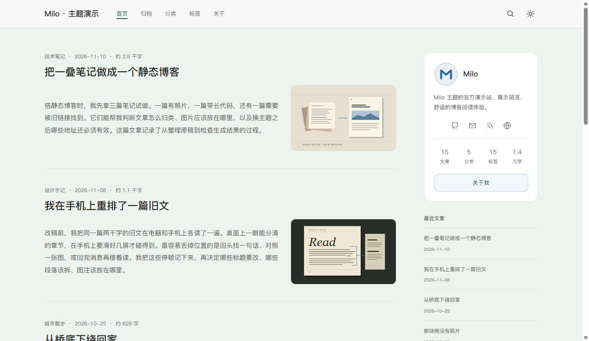
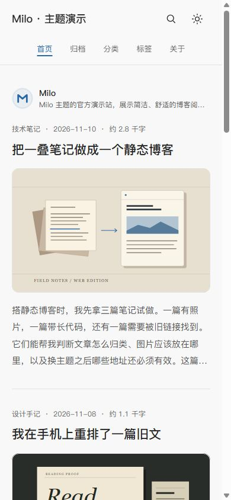
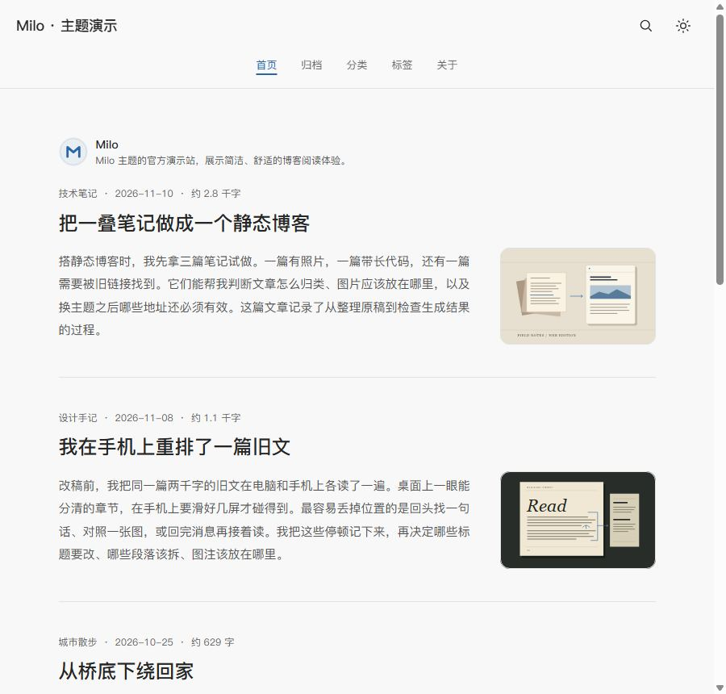
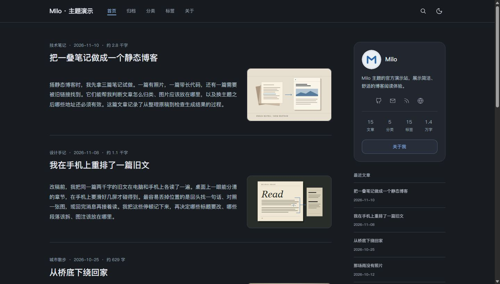
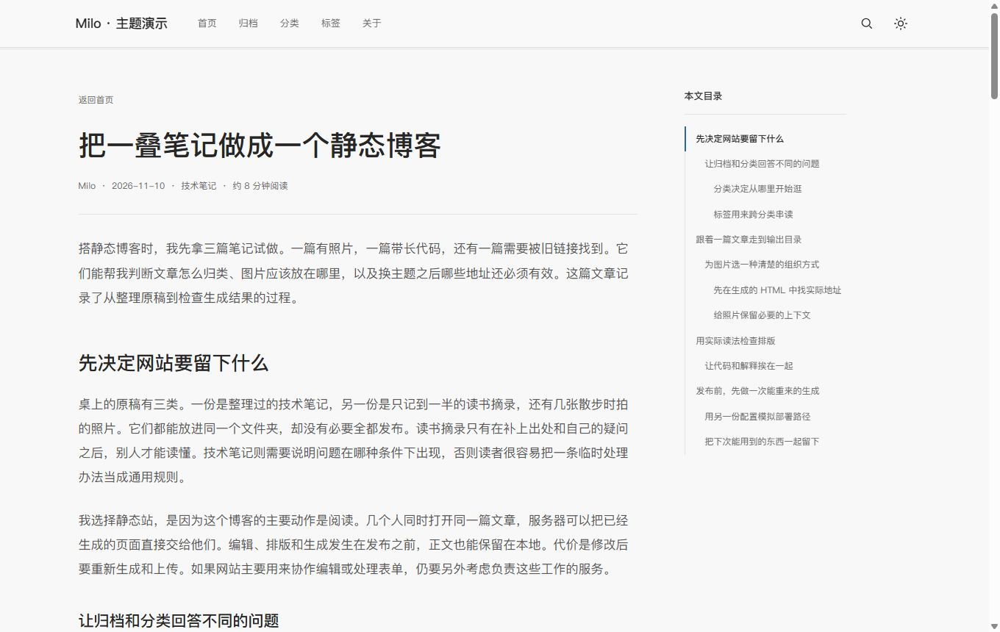
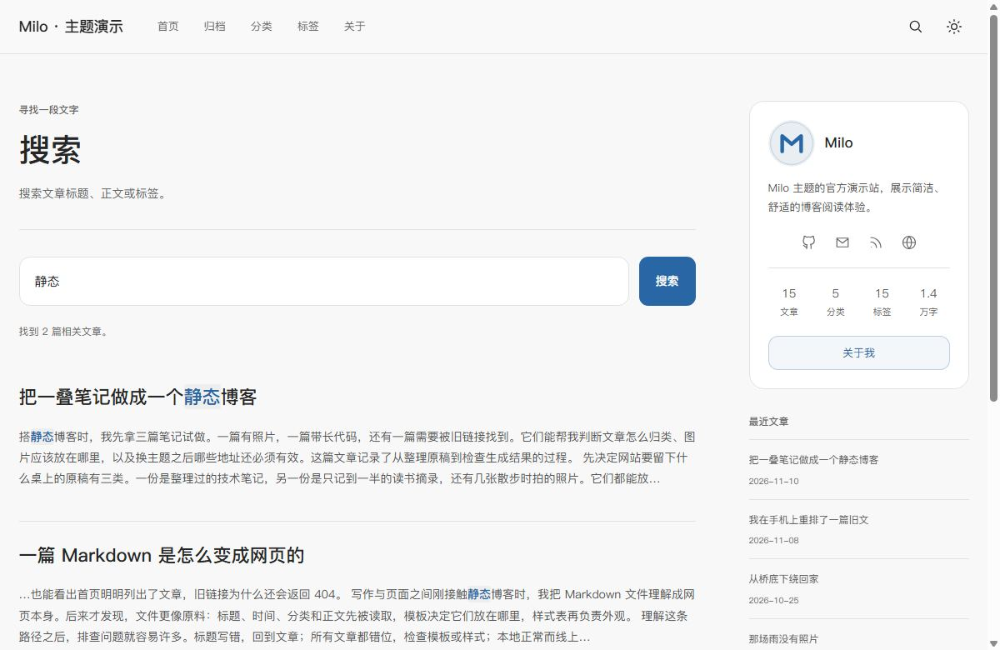

# Milo user guide

[Project home](../../README.en.md) · [简体中文](../zh-CN/README.md) · [Configuration reference](configuration.md)

## Installation

1. Install a supported Node.js LTS release. Run `node -v` and `npm -v` to check it. Git installation also requires `git --version` to work. Milo has been tested with Hexo 8.1.2 and Node.js 22, 24, and 26. Milo requires Node.js 18+, and Hexo 8.1.2 requires Node.js 20.19+.
2. For an existing site, enter its root directory. For a new site, run these commands from a directory outside any existing npm project. They use the template bundled with Hexo CLI.

   ```sh
   npx --yes hexo-cli init milo-blog --no-install --no-clone
   cd milo-blog
   npm install hexo@8.1.2 hexo-renderer-ejs hexo-renderer-marked@7 hexo-generator-index hexo-generator-archive hexo-generator-category hexo-generator-tag hexo-server
   ```

3. Choose one way to install the theme. For an existing site missing the renderer, generators, or preview server, use the package list above and keep your current Hexo version if compatible.

   | Method | Steps |
   | --- | --- |
   | npm (recommended) | Run `npm install hexo-theme-milo` from the site root. npm installs Milo and its build dependencies. To pin this release, use `npm install hexo-theme-milo@0.6.0`. |
   | Git | From the site root run `git clone https://github.com/twhao/hexo-theme-milo.git themes/milo`, then `npm install --prefix themes/milo --omit=dev`. To pin a version, list tags with `git -C themes/milo tag --list`, switch with `git -C themes/milo switch --detach <published-tag>`, and install that version's dependencies. |
   | Source archive | Choose a published version from the release page. Place the extracted directory containing `layout/`, `scripts/`, and `package.json` at `themes/milo/`, then run `npm install --prefix themes/milo --omit=dev`. Check that the archive has no extra enclosing folder inside `themes/milo/`. |

   [Hexo setup](https://hexo.io/docs/setup) · [Milo releases](https://github.com/twhao/hexo-theme-milo/releases)

4. Edit the existing `_config.yml` in the site root. Keep one copy of each key.

   ```yaml
   title: Reading Notes
   author: Alex Reader
   description: Notes on reading and writing
   language: en
   theme: milo
   url: https://example.com
   root: /
   ```

5. Choose the [English-commented template](../../_config.en.yml.example) or the [Chinese-commented template](../../_config.yml.example) from the theme directory, and copy it to your site root as `_config.milo.yml`. The theme directory is `themes/milo/` for Git or source archive installs and `node_modules/hexo-theme-milo/` for npm installs. Keep any existing `_config.milo.yml` and add only the settings you need. The site's `theme_config` takes precedence over the separate theme config. See the [reference](configuration.md) for settings and paths.

6. From the site root, run these commands and open the local address shown in the terminal, typically `http://localhost:4000/`. Press Ctrl+C to stop the server.

   ```sh
   npx hexo clean
   npx hexo server --ip 127.0.0.1
   ```

### Install from a local npm tarball

For local development or offline installation, download `hexo-theme-milo-0.6.0.tgz` from the [GitHub Release](https://github.com/twhao/hexo-theme-milo/releases/tag/v0.6.0), or run `npm pack` in the theme source directory. Put the tarball in the Hexo site root and run `npm install ./hexo-theme-milo-0.6.0.tgz`. Offline installation requires the theme dependencies to be available in npm's cache.

### Build and deploy

Set `url` to the public site address. For subdirectory hosting, also set `root`. For example, use `url: https://example.com/blog` with `root: /blog/`. Run:

```sh
npx hexo clean
npx hexo generate
```

Check `public/` locally and upload its contents to the corresponding directory on your host. Search requires HTTP access. To use `npx hexo deploy`, install the deployer for your host and configure `deploy` separately. Configure the host to serve `404.html` for missing pages with HTTP status 404. [Hexo deployment guide](https://hexo.io/docs/one-command-deployment)

## Appearance and author profile

- **Site identity.** Set `title` and `author` in the site config. Use `img.avatar`, `uiux.slogan`, and `head.favicon.ico` in the theme config. Put local images under `source/images/` and reference them as `/images/avatar.png`, for example.
- **Appearance.** Use the button in the upper right to follow the system or select light or dark. The browser remembers the visitor's choice. The color settings apply to the light background, link accent, and button color. Dark mode uses Milo's dark palette. Quote CSS color values such as `'#315c46'`.
- **Author links.** `social` supports GitHub, email, feeds, personal websites, and custom platforms. Links appear in the desktop author card and on the about page. Mobile readers can reach the about page from the homepage author link.
- **Footer.** Set the starting year with `footer.copyright_since`. Use `footer.custom_text` for your own text or trusted HTML. The technical credit always uses English and shows the installed versions.
- **Language.** Set site `language: zh-CN` or `language: en`. With no language setting, Milo uses Simplified Chinese. If none of the selected languages is supported, it uses English. Posts, categories, tags, bios, and custom menu labels keep their original text.
- **Copyable examples.** Find the complete theme configuration and an author links example in the [configuration reference](configuration.md#theme-configuration).







## Pages and navigation

Hexo generates the homepage and posts through its normal writing workflow. With the index, archive, category, and tag generators installed, archives and each populated category or tag have their own pages. The default home and archive links are `/` and `/archives/`. Site `per_page` controls pagination. Set it to `0` to show every entry on one page. Each generator can override the page size.

Create the category index, tag index, about page, and search page yourself. Copy the templates from the theme's `examples/pages/` directory:

| Theme template | Site file | `layout` | Default link |
| --- | --- | --- | --- |
| `categories.md` | `source/categories/index.md` | `categories` | `/categories/` |
| `tags.md` | `source/tags/index.md` | `tags` | `/tags/` |
| `about.md` | `source/about/index.md` | `about` | `/about/` |
| `search.md` | `source/search/index.md` | `search` | `/search/` |

For example, create `source/about/index.md`:

```markdown
---
title: About
layout: about
comments: false
---

Here is what I write about.
```

The default menu shows home, archives, categories, tags, and about in the interface language. Set `menu` to a mapping of labels to paths to customize its contents and order. You can omit links to pages you have yet to create. The theme's author and search shortcuts still use `/about/` and `/search/`.

Milo generates `404.html`. To customize it, put a complete HTML document at `source/404.html` or create a Hexo page whose output path is `404.html`. Your page takes precedence.

## Features

### Search and reading

- **Search** is on by default. In `/search/` or the navigation bar, enter a phrase from a title, post body, or tag. The build creates a public `search.json`. The browser matches the contiguous query and highlights results. Set `search.enable: false` to turn off the index and navigation search. To remove the search page as well, move or delete its source file and rebuild.
- **Table of contents** is on by default and follows post heading levels. It sits beside the article on desktop and can be expanded above the body at narrower widths. To hide it on a post, set `toc: false`.
- **Reading progress** appears below the navigation by default. Use `reading.progress: false` to disable it site-wide.
- **Code copying** adds a copy button automatically to code blocks. If clipboard permissions block it, select and copy text manually. Use Markdown fenced code blocks with a language identifier when appropriate.
- **Lightbox** is off by default. Set `reading.lightbox: true` to open supported article images by pointer or keyboard. Press Esc to close. Linked images keep their original destination. Set `lightbox: false` on a post, or add `data-no-lightbox` to an HTML image to exclude that image.
- **Sticky sidebar** is on by default. Set `sidebar.sticky: false` to unpin recent posts and categories. The sidebar is hidden in single-column layouts.




### Disqus comments

1. Sign up for Disqus and register a forum for your site. Choose and record its **shortname**, the unique forum identifier. If you configure trusted domains in Disqus admin, add the actual site domain. [Disqus publisher quick start](https://help.disqus.com/en/articles/1717056-publisher-quick-start-guide) · [Trusted domains](https://help.disqus.com/en/articles/1717206-how-to-use-trusted-domains)
2. Put the actual shortname in `_config.milo.yml` in your site root and regenerate.

   ```yaml
   comment:
     disqus:
       shortname: 'example-forum'
   ```

3. Open a post on a staging or production site with the correct `url`. Click **Load comments** and confirm that the displayed discussion belongs to your forum. Milo requests Disqus after the click and identifies the discussion by the post's canonical URL. Set `comments: false` to hide comments on one post or clear the shortname to disable comments site-wide. If loading fails, check the domain, shortname, service connectivity, and content blockers. Milo needs no separate Hexo comment plugin. [Disqus troubleshooting](https://help.disqus.com/en/articles/1717061-installation-troubleshooting)

### Feeds and sharing

- **Atom feed.** Milo generates `/atom.xml` with summaries of the latest 20 posts by default. Set `feed.limit` in the theme config to change the count, or `feed.enable: false` to disable it. If the site already has a feed generator, that plugin takes over output. Set the site `feed.path` according to its documentation.
- **Subscription link.** `social.rss: true` links to the first available feed location. You can also supply an existing local or external feed URL. For RSS 2.0, run `npm install hexo-generator-feed` and use the site configuration below. Milo's built-in output uses Atom. [Hexo feed generator](https://github.com/hexojs/hexo-generator-feed)
- **SEO and sharing.** Milo adds canonical URLs, descriptions, Open Graph, and Twitter Card metadata. Set `url`, `root`, `title`, and `description` in the site config. Posts use the excerpt first, then post `description`, body, and site description. The share image is selected from post `cover`, `thumbnail`, theme `seo.image`, avatar, and the bundled image in that order. Use a publicly accessible HTTPS URL for a remote share image.

```yaml
feed:
  type: rss2
  path: rss2.xml
  limit: 20
```

After rebuilding, open `/rss2.xml` and check that your feed reader can parse it. This `feed` block belongs in the site's `_config.yml`. Keep `feed.enable: true` in the theme configuration to keep feed discovery links.

## Writing posts

Run `npx hexo new post "Reading Notes"` in the site root, put images in `source/images/`, and set the fields you need at the top of the new post:

```markdown
---
title: Reading Notes
date: 2026-01-12 09:00:00
categories: [Notes]
tags: [Reading]
cover: /images/reading.jpg
cover_fit: contain
description: A post on reading habits
toc: true
comments: false
lightbox: false
---

This is the homepage excerpt.

<!-- more -->

## Article


~~~js
console.log('Hello Milo');
~~~
```

- `cover` sets the cover image. `thumbnail` is a compatible alternative, with `cover` taking priority. Both accept a site path or HTTP(S) image URL. With neither set, Milo leaves the cover empty.
- The cover frame is 16:10. Use `cover_fit: cover` or omit the field to fill the frame. Use `contain` to show the full image. This setting only affects the list cover.
- Put the summary above `<!-- more -->`. Milo prefers Hexo's excerpt, then extracts plain text from the body. It takes up to 210 characters and limits visible lines to fit the list layout.
- Add descriptive alt text to Markdown images. You can set dimensions explicitly in HTML, for example ``. Use the image's actual aspect ratio. Milo tries to detect dimensions for local images. Add width and height yourself for remote images when possible.
- Set `toc`, `comments`, or `lightbox` to `false` to disable the corresponding feature on one post. Setting them to `true` still requires the site feature to be enabled or Disqus to be configured. See [all post and page fields](configuration.md#post-and-page-fields).

### Responsive WebP

Generate the variants in advance, put them beside the original under `source/images/`, and map the original reference to variants in the theme config:

```yaml
img:
  responsive:
    /images/reading.jpg:
      - /images/reading-480.webp
      - /images/reading-960.webp
```

Use the exact original reference from the post or cover as the key. Variant files must be readable local WebP images. The browser chooses a size and Milo skips missing candidates. The original remains the format fallback and opens in the lightbox for Milo-generated responsive images. Existing `picture` and `srcset` markup remains author-managed. Milo leaves image conversion to your own tools.

With subdirectory hosting, the Markdown renderer may change the body image's `src` to `/blog/images/reading.jpg`. If the cover and body share that image, keep the mapping key `/images/reading.jpg` and add `/blog/images/reading.jpg`. Both keys can use the same list of variants.

## Upgrade and uninstall

1. Back up the site's `_config.yml`, `_config.milo.yml`, `source/`, `package.json`, and lockfile. Move any settings you previously put in the theme directory to the site's `_config.milo.yml`.
2. Update using your installation method. For npm, run `npm install hexo-theme-milo@latest` in the site root, or specify the published version you want, for example `npm install hexo-theme-milo@0.6.0`. For Git on the default branch, run `git -C themes/milo pull --ff-only`. To update a pinned version, run `git -C themes/milo fetch --tags` and switch to the chosen tag. Reinstall theme dependencies for either Git workflow. For a source archive, back up the old theme directory and replace it with the new one before installing dependencies.
3. Run `npx hexo clean` and `npx hexo generate`. Check the homepage, a post, and your settings before deployment.
4. To uninstall, first point the site's `theme` at a different installed theme. Run `npm uninstall hexo-theme-milo` for an npm install. For Git or an archive, move `themes/milo/` outside the site as a backup. You can keep the site configuration and source content.

## Troubleshooting

| Problem | What to check |
| --- | --- |
| Installation fails or the theme is missing | Check that you are in the site root, your Node.js version meets the requirements, and the site sets `theme: milo`. Check directory nesting and installed dependencies. Hexo uses `themes/milo/` first when both install methods are present. |
| Changes have no effect | Confirm the site root contains `_config.milo.yml`. Check YAML indentation, duplicate keys, and `theme_config` overrides. Clean and rebuild, then restart the preview if needed. |
| An image is missing | Check the exact filename under `source/` and open the generated URL in the browser. For subdirectory hosting, check `url` and `root`. Look for the image in `public/`. |
| A menu page is missing | Create the page source with the correct `layout`. Archives and category or tag detail pages require the corresponding generators. Detail pages also need at least one associated post. |
| Search returns no results or fails | Use HTTP access, enable `search.enable`, create the search page, and check for published posts and a 200 response for `search.json`. Try an exact phrase from a title. |
| The comment button or panel is missing | Check the shortname and post `comments`. Click the button to load the panel. For request failures, check trusted domains, connectivity, and content blockers. |
| Upgrade fails or shows the earlier version | Check the version in the footer and look for another `themes/milo/` directory. Back up local Git changes and follow the correct branch or tag workflow. Restore the backup and prior version to roll back. |
| Asset URLs fail under a subdirectory | Set both `url: https://example.com/blog` and `root: /blog/`, regenerate, and place the contents of `public/` at that mount point. |
