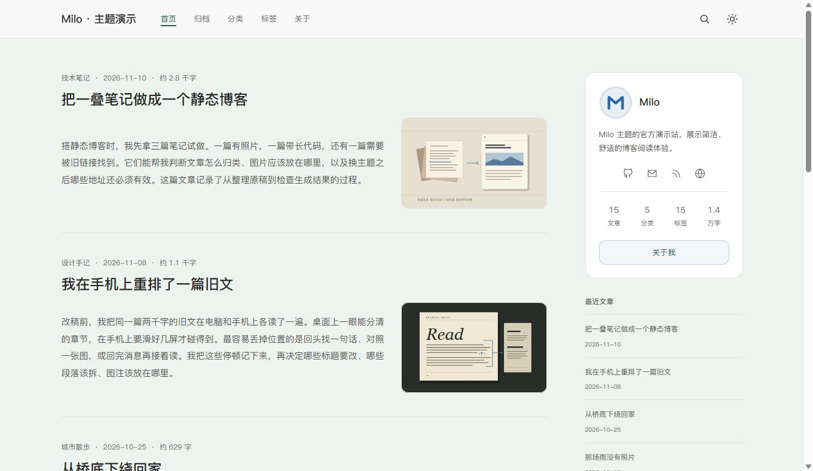
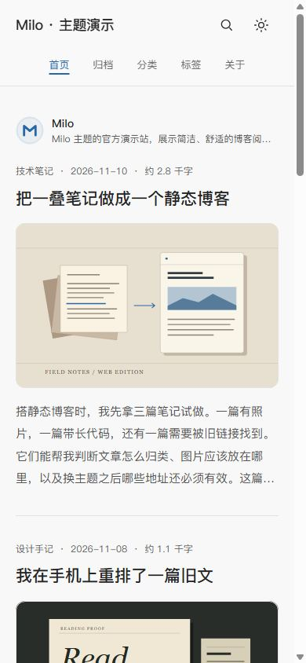
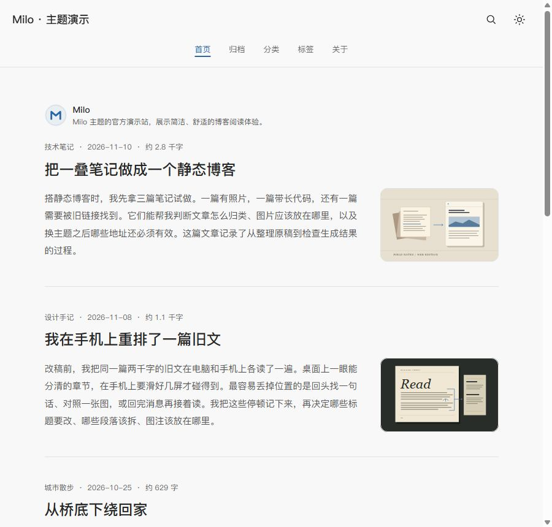
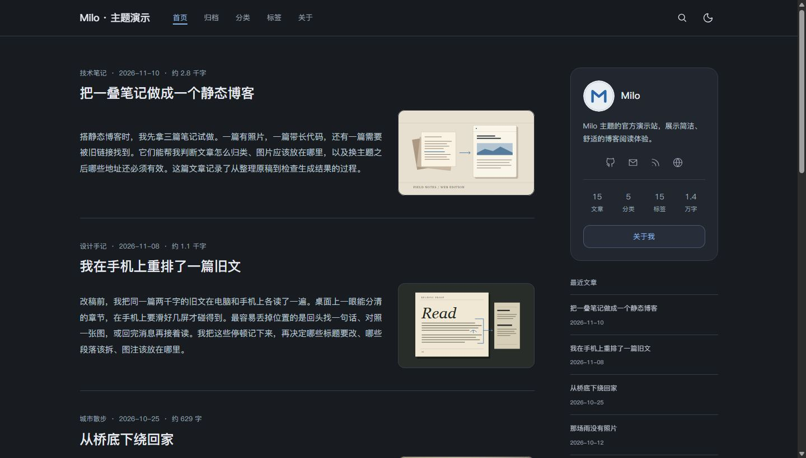
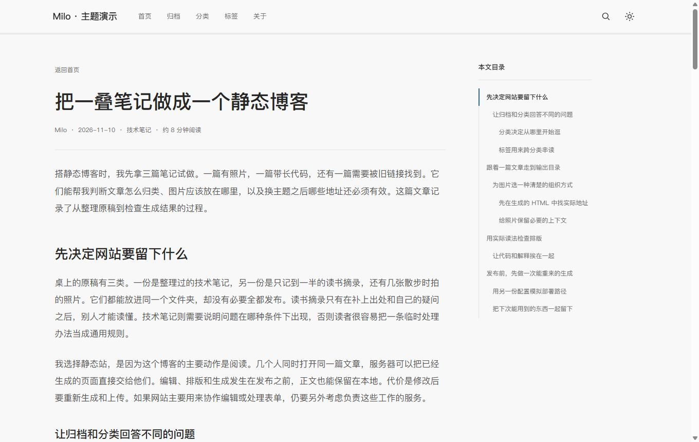
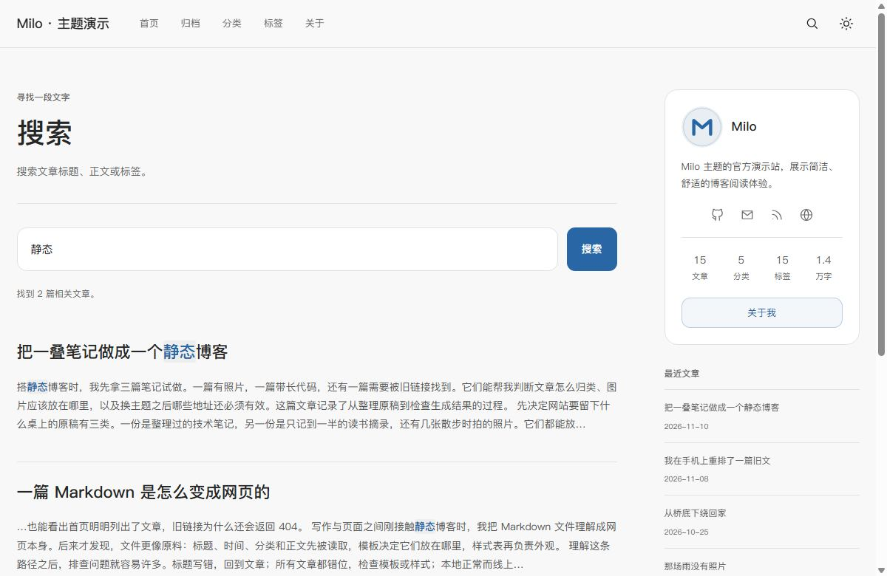

# Milo 使用指南

[项目首页](../../README.md) · [English](../en/README.md) · [完整配置参考](configuration.md)

## 安装与入门

1. 安装受支持的 Node.js LTS，再用 `node -v` 和 `npm -v` 确认环境。Git 安装需要 `git --version` 能正常运行。已验证 Hexo 8.1.2 和 Node.js 22、24、26。主题要求 Node.js 18+，Hexo 8.1.2 要求 Node.js 20.19+。
2. 已有站点可直接进入其根目录。首次建站时，进入现有 npm 项目之外的目录，初始化站点并安装依赖。以下命令使用 Hexo CLI 自带的模板。

   ```sh
   npx --yes hexo-cli init milo-blog --no-install --no-clone
   cd milo-blog
   npm install hexo@8.1.2 hexo-renderer-ejs hexo-renderer-marked@7 hexo-generator-index hexo-generator-archive hexo-generator-category hexo-generator-tag hexo-server
   ```

3. 从以下三种方式中选一种安装主题。已有站点缺少渲染器、生成器或预览服务时，也可执行上面的安装命令，已有站点可保留自身兼容的 Hexo 版本。

   | 方式 | 操作 |
   | --- | --- |
   | npm 本地包 | 在候选版源码目录运行 `npm pack`。将生成的 `hexo-theme-milo-0.6.0.tgz` 放到站点根目录，运行 `npm install ./hexo-theme-milo-0.6.0.tgz`。npm 会安装 Milo 的构建依赖。正式上架后才可使用 `npm install hexo-theme-milo`。 |
   | Git | 在站点根目录运行 `git clone https://github.com/twhao/hexo-theme-milo.git themes/milo`，再运行 `npm install --prefix themes/milo --omit=dev`。克隆后可用 `git -C themes/milo tag --list` 查看可用标签，并用 `git -C themes/milo switch --detach <已发布的标签>` 固定版本，再安装该版本依赖。 |
   | 源码压缩包 | 从版本下载页选择已发布版本。将包含 `layout/`、`scripts/`、`package.json` 的解压目录放在 `themes/milo/`，再执行 `npm install --prefix themes/milo --omit=dev`。展开后避免多套一层同名目录。 |

   [Hexo 安装与建站](https://hexo.io/docs/setup) · [Milo 版本下载](https://github.com/twhao/hexo-theme-milo/releases)

4. 编辑博客根目录已有的 `_config.yml`，修改对应键。一个文件里的同名键只保留一份。

   ```yaml
   title: 阅读笔记
   author: 林读者
   description: 记录读书与写作
   language: zh-CN
   theme: milo
   url: https://example.com
   root: /
   ```

5. 从主题目录选择[中文注释模板](../../_config.yml.example)或[英文注释模板](../../_config.en.yml.example)，复制到站点根目录并命名为 `_config.milo.yml`。Git 和压缩包的主题目录是 `themes/milo/`，npm 安装的主题目录是 `node_modules/hexo-theme-milo/`。已有 `_config.milo.yml` 时保留并补充所需字段。站点根目录 `_config.yml` 内的 `theme_config` 优先于独立主题配置，排查配置时也要检查那里。主题默认相对路径和站点字段详见[配置参考](configuration.md)。

6. 从站点根目录执行以下命令。打开终端地址，通常是 `http://localhost:4000/`。按 Ctrl+C 停止预览。

   ```sh
   npx hexo clean
   npx hexo server --ip 127.0.0.1
   ```

### 构建与部署

发布前将 `url` 改为实际站点地址。发布到子路径时同时指定 `root`，如 `url: https://example.com/blog` 和 `root: /blog/`。运行：

```sh
npx hexo clean
npx hexo generate
```

本地检查 `public/`，再将其内容上传到托管平台的对应站点根目录。搜索需要通过 HTTP 访问。使用 `npx hexo deploy` 的站点还需自行安装所选部署插件并配置 `deploy`。在托管平台将缺失页面指向 `404.html`，并保留 HTTP 404 状态。[Hexo 部署文档](https://hexo.io/docs/one-command-deployment)

## 外观与个人品牌

- **站点身份**。在站点配置修改 `title` 和 `author`。在主题配置使用 `img.avatar`、`uiux.slogan` 和 `head.favicon.ico`。将本地图像放在 `source/images/`，以 `/images/avatar.png` 形式引用。
- **外观模式**。右上角外观按钮可选择跟随系统、深色或浅色。浏览器保存访客的选择。颜色字段设置浅色背景、强调链接色和按钮色，深色模式仍使用 Milo 的深色配色。颜色使用带引号的 CSS 颜色值，如 `'#315c46'`。
- **作者链接**。主题配置的 `social` 支持 GitHub、邮箱、订阅、个人网站及自定义平台。配置后出现在桌面作者卡片和关于页。手机可从首页作者入口进入关于页。
- **页脚**。`footer.copyright_since` 填起始年份，`footer.custom_text` 填站点自己的文字或可信的 HTML。技术署名始终使用英文，并显示实际版本号。
- **语言**。站点 `language: zh-CN` 或 `language: en` 控制界面，省略时使用简体中文。所有指定语言均不受支持时使用英文。文章、分类、标签、作者简介及自定义菜单文字照常显示原文。
- **可复制示例**。主题配置和社交链接的完整 YAML 见[配置参考](configuration.md#主题配置)。







## 页面与导航

首页和文章由正常的 Hexo 写作流程生成。安装首页、归档、分类和标签生成器后，归档及有文章的分类、标签详情会自动生成。默认首页、归档链接是 `/` 和 `/archives/`。分页用站点的 `per_page` 设置，`0` 表示关闭分页。各生成器可单独覆盖分页数量。

分类总览、标签总览、关于页和搜索页需要手动创建。将主题 `examples/pages/` 下的示例分别复制成：

| 主题示例文件 | 站点文件 | `layout` | 默认链接 |
| --- | --- | --- | --- |
| `categories.md` | `source/categories/index.md` | `categories` | `/categories/` |
| `tags.md` | `source/tags/index.md` | `tags` | `/tags/` |
| `about.md` | `source/about/index.md` | `about` | `/about/` |
| `search.md` | `source/search/index.md` | `search` | `/search/` |

例如创建 `source/about/index.md`：

```markdown
---
title: 关于
layout: about
comments: false
---

这里介绍我写作的主题。
```

Milo 的默认菜单按界面语言显示首页、归档、分类、标签和关于。用 `menu` 映射自定义标签和路径，顺序按配置排列。若暂时未创建对应页面，可用自定义菜单省略该项。固定的作者入口和搜索入口仍使用 `/about/`、`/search/`。

Milo 自动生成 `404.html`。如需自定义，创建 `source/404.html` 放完整 HTML，或者使用输出路径为 `404.html` 的 Hexo 页面。自带页面优先。

## 功能配置

### 搜索与阅读

- **搜索**默认开启。在 `/search/` 或导航栏搜索中输入标题、正文或标签里的文字。构建生成公开的 `search.json`，浏览器按连续查询词匹配并高亮结果。无需远程服务。设 `search.enable: false` 可关闭索引和导航搜索；如果也想移除搜索页面，删除或移走站点的搜索页源文件后重新构建。
- **目录**默认开启，使用文章标题层级生成。桌面显示在正文旁，较窄视口可展开正文顶部目录。单篇文章设置 `toc: false` 可隐藏。
- **阅读进度**默认在导航下显示，可通过 `reading.progress: false` 全站关闭。
- **代码复制**自动为代码块添加按钮。点击即可复制代码，剪贴板权限受限时可手动选择文本。正文可使用带语言标记的 Markdown 围栏代码。
- **灯箱**默认关闭，设置 `reading.lightbox: true` 后可点击或用键盘打开支持的正文图片，按 Esc 关闭。已有链接的图片保留原目标。用 `lightbox: false` 关闭单篇文章的灯箱，或在 HTML 图片上加 `data-no-lightbox` 排除单张图。
- **侧栏吸附**默认开启，用 `sidebar.sticky: false` 关闭最近文章和分类区域的吸附。单栏布局不显示侧栏。




### Disqus 评论

1. 在 Disqus 注册账号，为站点创建论坛。选择并记录 **shortname**，即论坛唯一标识。若管理后台配置了受信任域名，将真实站点域名加入允许列表。[Disqus 接入指南](https://help.disqus.com/en/articles/1717056-publisher-quick-start-guide) · [受信任域名](https://help.disqus.com/en/articles/1717206-how-to-use-trusted-domains)
2. 在站点根目录的 `_config.milo.yml` 填入实际 shortname，然后重新生成站点。

   ```yaml
   comment:
     disqus:
       shortname: 'example-forum'
   ```

3. 在配置了实际 `url` 的测试或正式站点打开文章，点击「加载评论」。确认嵌入的讨论区属于自己的论坛。Milo 在点击前不会请求 Disqus，讨论串使用文章的规范 URL。可用 `comments: false` 隐藏单篇评论；清空 shortname 可停用整站评论。出现加载失败时检查域名、shortname、服务可达性和内容拦截器。无需安装 Hexo 评论插件。[Disqus 故障排查](https://help.disqus.com/en/articles/1717061-installation-troubleshooting)

### Atom、RSS 与分享信息

- **订阅**默认生成 `/atom.xml`，包含最新 20 篇文章的摘要。在主题配置用 `feed.limit` 修改数量，或用 `feed.enable: false` 关闭。若已有站点订阅生成器，由它负责输出，并按站点插件文档配置 `feed.path`。
- **订阅入口**用 `social.rss: true` 链接到已有的第一个订阅地址。也可填现成的站内或外部订阅 URL。需要 RSS 2.0 文件时，运行 `npm install hexo-generator-feed`，在站点配置使用下方示例。Milo 自带的文件格式是 Atom。[Hexo 订阅生成器](https://github.com/hexojs/hexo-generator-feed)
- **SEO 与分享**自动生成 canonical、描述、Open Graph 和 Twitter Card。正确配置站点的 `url`、`root`、`title`、`description`。文章描述优先使用摘要，再用文章 `description`、正文和站点描述。分享图按文章 `cover`、`thumbnail`、主题 `seo.image`、头像、内置图片顺序选择。远程分享图使用可公开访问的 HTTPS 地址。

```yaml
feed:
  type: rss2
  path: rss2.xml
  limit: 20
```

重新生成后打开 `/rss2.xml`，确认订阅读取器可解析。这个 `feed` 区块位于站点 `_config.yml`。保留主题配置中的 `feed.enable: true` 可继续输出订阅发现链接。

## 文章写作

从站点根目录运行 `npx hexo new post "阅读笔记"`，将图片放到 `source/images/`，并在新文章顶部写入所需字段：

```markdown
---
title: 阅读笔记
date: 2026-01-12 09:00:00
categories: [随笔]
tags: [阅读]
cover: /images/reading.jpg
cover_fit: contain
description: 一篇记录阅读方法的文章
toc: true
comments: false
lightbox: false
---

这里是首页摘要。

<!-- more -->

## 正文


~~~js
console.log('Hello Milo');
~~~
```

- `cover` 指定封面，`thumbnail` 是兼容字段，二者同时设置时优先取 `cover`。封面可使用站内路径或 HTTP(S) 图片地址。无封面字段时首页不会自动选取正文第一张图。
- 首页封面比例为 16:10。省略 `cover_fit` 或用 `cover` 时填满画框；`contain` 保留整张图片。正文图片不受封面模式影响。
- 将摘要放在 `<!-- more -->` 之前。Milo 优先使用 Hexo 摘要，其次从正文提取纯文本，最多取 210 个字符，较长内容在列表中还会按版面限行。
- 正文 Markdown 图片应带描述性替代文本。对截图可用 HTML 指定尺寸，例如 ``。尺寸应与实际纵横比一致。Milo 尝试读取本地图像尺寸，远程图可自行填写宽高。
- `toc`、`comments`、`lightbox` 设为 `false` 可关闭单篇功能。设为 `true` 时仍依赖全站开关或有效 Disqus 配置。全部文章字段及默认行为见[配置参考](configuration.md#文章与页面字段)。

### 响应式 WebP

提前生成候选图，将其与原图放在 `source/images/`，再在主题配置映射原始引用和候选：

```yaml
img:
  responsive:
    /images/reading.jpg:
      - /images/reading-480.webp
      - /images/reading-960.webp
```

保持正文或封面的原图引用与映射键一致，候选必须是站内可读取的 WebP 路径。浏览器按尺寸挑选，缺失的候选会被跳过。原图保留作格式回退，Milo 生成的响应式图片用原图打开灯箱。现有 `picture` 或 `srcset` 由作者继续管理。Milo 本身不转换图片。

部署到子路径时，Markdown 渲染器可能会将正文图片的 `src` 改为 `/blog/images/reading.jpg`。如果封面和正文共用该图，同时保留映射键 `/images/reading.jpg` 并添加 `/blog/images/reading.jpg`，两项可共用同一份候选列表。

## 升级与卸载

1. 备份站点 `_config.yml`、`_config.milo.yml`、`source/`、`package.json` 和锁文件。把以前直接写在主题目录中的设置迁到站点的 `_config.milo.yml`。
2. 按安装方式更新。npm 用户在站点根目录用 `npm install ./hexo-theme-milo-0.6.0.tgz` 更新包。正式上架的版本可使用 `npm install hexo-theme-milo@版本号`。Git 默认分支可运行 `git -C themes/milo pull --ff-only`，固定版本先 `git -C themes/milo fetch --tags` 再切到选定标签。两种 Git 更新都需重新安装主题依赖。压缩包方式先备份旧目录，再换成新目录并安装依赖。
3. 运行 `npx hexo clean` 和 `npx hexo generate`，检查首页、文章和配置后再部署。
4. 卸载前先将站点 `theme` 改为另一个已安装的主题。npm 安装可运行 `npm uninstall hexo-theme-milo`。Git 或压缩包安装可将 `themes/milo/` 移到站点外保留备份。站点的 `_config.milo.yml` 和源内容可保留。

## 常见问题

| 问题 | 检查方法 |
| --- | --- |
| 安装失败或提示找不到主题 | 确认当前目录是 Hexo 站点根目录、Node.js 版本满足要求、`theme: milo` 已设置。确认实际主题目录层级及依赖已安装。npm 版与 `themes/milo/` 同时存在时 Hexo 优先使用目录版。 |
| 配置未生效 | 检查根目录是否为 `_config.milo.yml`，YAML 缩进和同名键是否正确，站点 `theme_config` 是否覆盖了设置。清理构建，必要时重启本地服务。 |
| 图片不显示 | 核对对应文件在 `source/` 下及大小写，浏览器直接访问生成后的地址。子路径部署时同时核对 `url` 和 `root`。检查图片是否也出现在 `public/`。 |
| 菜单页面不存在 | 创建对应页面源文件并确认 `layout`。归档和分类／标签详情需安装生成器；分类和标签详情还需有关联文章。 |
| 搜索无结果或报错 | 通过 HTTP 打开站点，确认 `search.enable: true`、已创建搜索页、有公开文章且 `search.json` 返回 200。尝试标题中的一段连续词。 |
| 评论按钮或讨论区不显示 | 检查 shortname 和文章 `comments`。按钮出现后需要点击，若请求失败，检查受信任域、连接和浏览器拦截。 |
| 更新失败或更新后仍显示旧版 | 查看页脚版本，检查是否同时存在另一份 `themes/milo/`。Git 有本地改动或处于标签时，先备份并按对应方式升级。用备份和原版本可回退。 |
| 站点发布到子路径后资源 404 | 同时设置 `url: https://example.com/blog` 和 `root: /blog/`，重新生成并把 `public/` 的内容上传到站点实际挂载目录。 |
